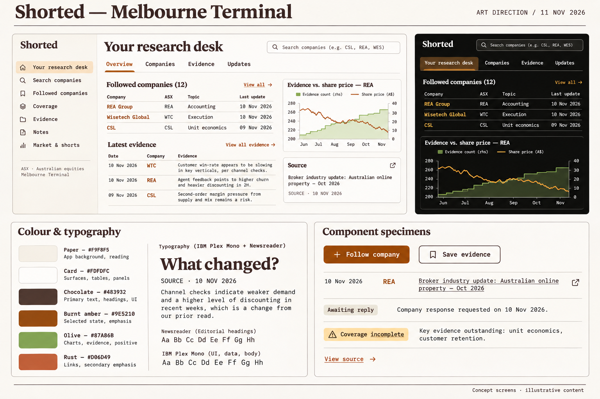
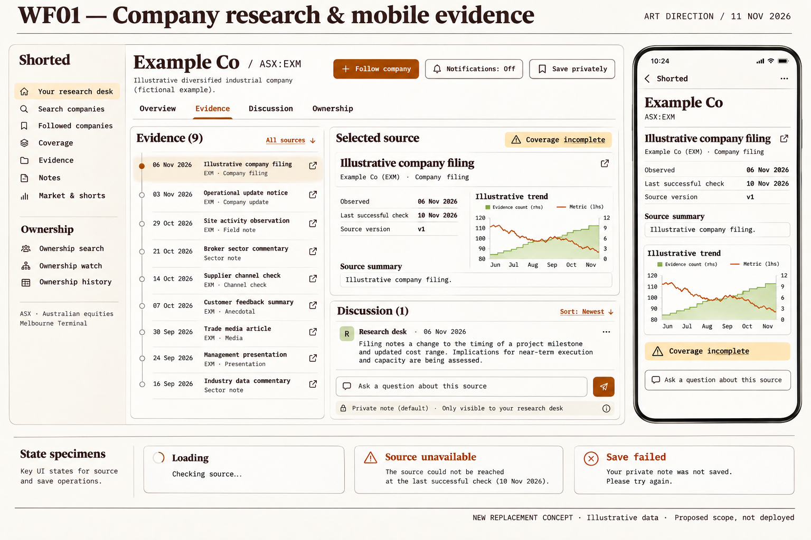
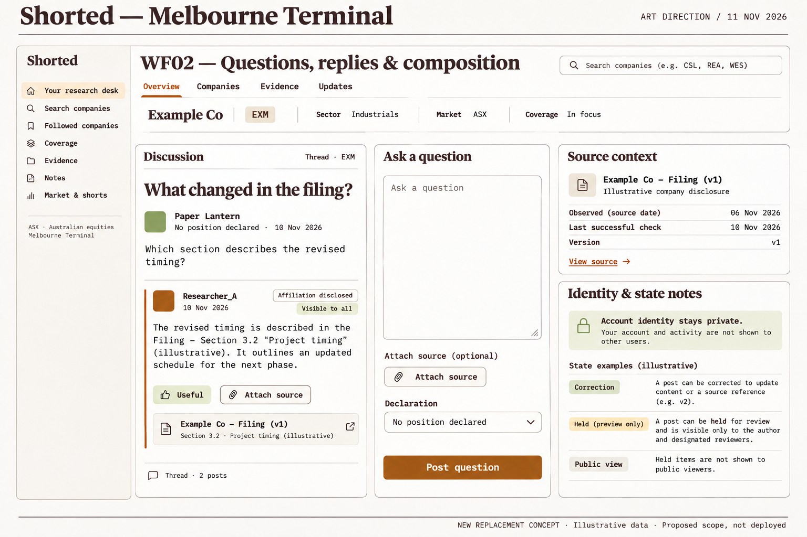
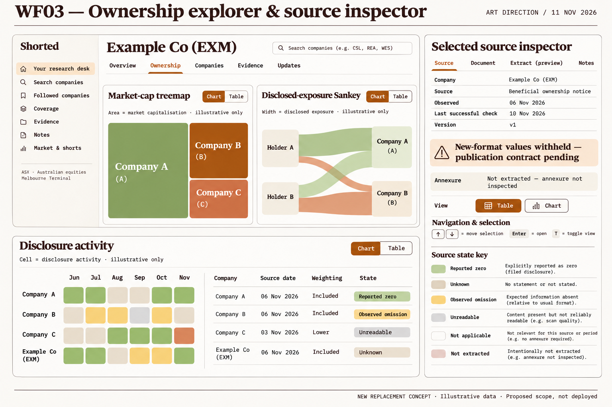
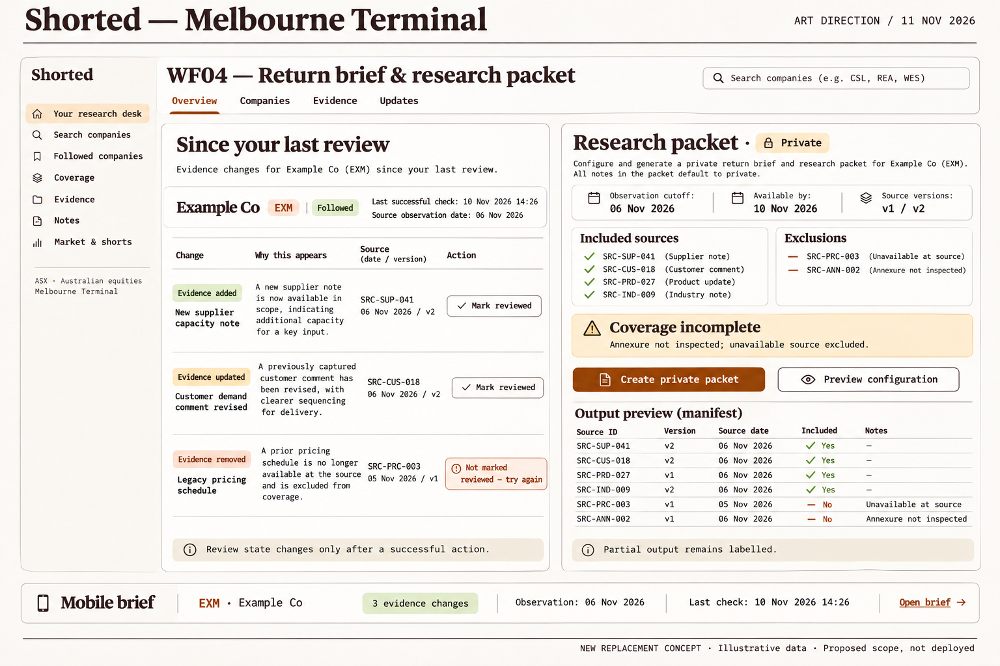
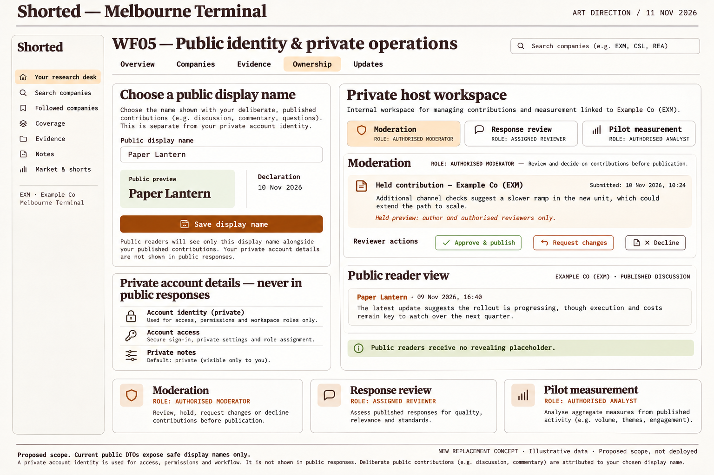

# Shorted research visual assets

Recovered 11 November 2026. These are illustrative design concepts, not implemented features or validated market data.

## Recovery record

The original D01 art-direction PNG was recovered intact from the saved design asset and visually inspected. The [design source page](https://chatgpt.com/space/page_b16e2b88b61881918a4c8a18461a10f6) contained written D01 and WF01–WF05 specifications but no embedded image references when inspected. The research branch at `85811fe7fbc02e712ca07826abfcf577d67ba9be` contained seven research documents and no research visuals. Older November 3 ownership mockups are distinct work and are not relabeled as these wireframes.

The original D01 is retained without image edits. Its example company claims and chart shapes are fictional illustrative content, not research findings. It is a style exploration; [DESIGN.md](../../../DESIGN.md), source semantics and the written acceptance criteria govern implementation. In particular, preserve existing navigation and do not infer investment accuracy from evidence counts.

## D01: recovered original

## Replacement wireframes

WF01–WF05 are newly generated replacement concepts, not recovered originals. The original wireframe image files could not be located through the available saved assets; their written specifications were recovered from the source page. The replacements use D01 as their visual reference and are visibly labeled as new, illustrative, proposed scope. Existing research documents and older ownership designs are preserved.

### WF01 — Company research and mobile evidence

### WF02 — Questions, replies and composition

### WF03 — Ownership explorer and source inspector

### WF04 — Return brief and research packet

### WF05 — Public identity and private host states

Full generation prompts and review notes: [provenance manifest](visuals/generation-provenance.json).

## Review notes and implementation constraints

- These raster concepts are not pixel-perfect implementation specifications. Preserve the existing site and ownership navigation rather than treating exploratory labels as a navigation migration.
- WF02's private-account note applies to private account identifiers and private activity. Deliberately public contributions remain public; the image must not be copied as a promise that all activity is private.
- WF03's observed omission requires an omission in an actually inspected source field. A usual-format expectation alone does not establish it. An uninspected annexure is not extracted. The source-state specimens beside the heatmap are separate semantics, not a validated activity scale or weighting formula.
- WF01's evidence-count and metric chart is illustrative layout, not a claim of predictive relationship or investment accuracy. Private saving and public question submission remain distinct flows.
- WF04: a currently unavailable source does not erase a retained prior version. Retention and cutoff rules determine whether an archived version remains eligible.
- All visual sample names, figures and market statements are illustrative. Follow the exact source/date/version, privacy, consent and release rules below.

## Wireframe specification

Proposed visual direction and screen designs for Shorted’s research workflow: follow a company, inspect dated evidence, discuss a focused question, return to changes and preserve a reproducible research packet. The concepts extend the existing Melbourne Terminal palette and typography. All sample content and chart shapes are illustrative; the written interaction rules and source semantics govern implementation.

**Design review date: 11 November 2026, Australia/Melbourne.** Existing implementation and release gates remain in the [delivery plan](https://chatgpt.com/space/page_a39dd18516248191821989c7470765b0). These boards add design acceptance criteria to the existing backlog; they do not mark features complete.

# Artistic direction

**D01 — Melbourne Terminal.** Warm paper and chocolate ink for reading, burnt amber for action and selection, restrained olive/rust categories, and a dark companion using warm sand and amber. IBM Plex Mono carries controls and data; Newsreader supplies editorial headings. Preserve the existing site and ownership navigation when implementing; the style board’s small application crops explore visual tone.

# Company research desk

**WF01 — Company research and mobile evidence.** Keep company context, observed date and last successful source check distinct. Follow, notifications and private saving are separate controls. The selected source remains visible beside the discussion entry point; on mobile it becomes a readable detail view. Owners: [#952](https://github.com/castlemilk/shorted.com.au/issues/952), [#953](https://github.com/castlemilk/shorted.com.au/issues/953), [#957](https://github.com/castlemilk/shorted.com.au/issues/957).

# Evidence discussion and composition

**WF02 — Question, replies and a lightweight composer.** A safe display name, dated declaration and source context accompany the contribution. Ordinary questions need no elaborate template. Useful acknowledgement, source attachment, affiliation and moderation visibility remain distinct. Owners: [#952](https://github.com/castlemilk/shorted.com.au/issues/952), [#953](https://github.com/castlemilk/shorted.com.au/issues/953), [#954](https://github.com/castlemilk/shorted.com.au/issues/954), [#963](https://github.com/castlemilk/shorted.com.au/issues/963).

# Ownership explorer

**WF03 — Major visualisations and a source inspector.** Retain the market-cap treemap, disclosed-exposure Sankey, activity heatmap and equivalent table. Explain each weighting and source date. New-format values remain withheld until the publication contract is ready; uninspected annexure values are not extracted. Owners: [#962](https://github.com/castlemilk/shorted.com.au/issues/962), [#971](https://github.com/castlemilk/shorted.com.au/issues/971), with [#957](https://github.com/castlemilk/shorted.com.au/issues/957).

# Return brief and research packet

**WF04 — Review changes and preserve the evidence.** The brief explains why each item appears and advances review state only after an explicit successful action. The packet fixes its observation cutoff, available-by boundary, source versions and exclusions. Incomplete coverage stays visible in the result. Owners: [#958](https://github.com/castlemilk/shorted.com.au/issues/958), [#961](https://github.com/castlemilk/shorted.com.au/issues/961), with [#957](https://github.com/castlemilk/shorted.com.au/issues/957), [#971](https://github.com/castlemilk/shorted.com.au/issues/971) and [#972](https://github.com/castlemilk/shorted.com.au/issues/972).

# Identity and private host states

**WF05 — Deliberate public identity and private operations.** Public display-name setup is separated from account identity. Moderation, response review and pilot measurement use separate private tabs and permissions. Held previews are visible only to their author and authorised reviewers; public readers receive no revealing placeholder. Owners: [#953](https://github.com/castlemilk/shorted.com.au/issues/953), [#955](https://github.com/castlemilk/shorted.com.au/issues/955), [#956](https://github.com/castlemilk/shorted.com.au/issues/956), [#963](https://github.com/castlemilk/shorted.com.au/issues/963).

# Shared design acceptance

- Source-linked evidence carries its relevant date and version. A fresh retrieval does not make an old observation current.

- Reported zero, unknown, observed omission, unreadable, not applicable and not extracted have different readable states.

- Follows, saves, declarations and notification consent use separate controls. Saved notes and packets default to private.

- Source counts, useful acknowledgements, affiliation checks and moderation decisions never imply investment accuracy.

- Mobile preserves the reading hierarchy and source context. Every chart selection has a table/list equivalent and a keyboard route.

- Loading, empty checked scope, stale/unavailable source, failed save, held content, correction and partial output are deliberate states.

- The A$19 continuation offer remains a research hypothesis under #972; no live upgrade or unlimited-verification promise is introduced.

# Design and implementation boundary

Current public DTOs expose safe display names only. Richer identity, follows, disclosures, review and packet controls in these concepts are proposed scope. The ownership sidecar remains unpublished, and its review metadata does not authorise public values. [#976](https://github.com/castlemilk/shorted.com.au/issues/976) retains the separate development-renderer privacy finding; [release hold #970](https://github.com/castlemilk/shorted.com.au/pull/970) remains in force.
